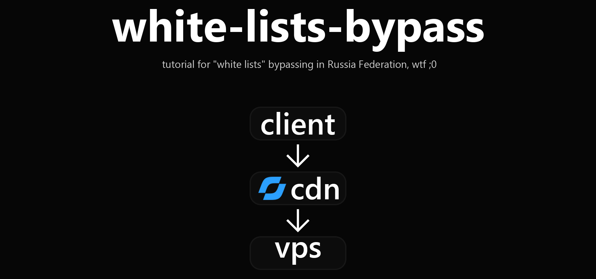

<div align="center">

# Обход белых списков через Yandex CDN + 3X-UI

</div>

<div align="center">
	<p>
		
	</p>
</div>

В этой статье мы разберем эффективный способ обхода белых списков с помощью Yandex CDN в связке с популярной панелью управления 3X-UI. Стоит отметить, что я не являюсь создателем этого метода обхода, а лишь предоставляю туториал. Так-же хочу подчеркнуть то, что если у вас нет базовых знаний команд Linux и/или понимания того, как работают блокировки, то эта статья не для вас. Автор не будет отвечать на вопросы школьного уровня. С порогом входа определилсь, теперь можно приступать. Для начала работы понадобится:
- VPS-сервер под управлением Debian 12
- Установленная панель 3X-UI
- Собственный домен
- Аккаунт в [Yandex Cloud](https://yandex.cloud/)

<div align="center">

# Подготовка домена и сертификатов

</div>

Для начала перейдите в панель управления вашим доменом и создайте первую A-запись, которая будет указывать на IP-адрес вашего VPS:

| Тип | Имя | Адрес         |
|-----|-----|---------------|
| A   | @   | ip_вашего_vps |

После этого подождите от 5 до 60 минут. Это зависит от вашего регистратора домена. Следующим шагом нам понадобится выпустить бесплатный SSL-сертификат Let's Encrypt через Certificate Manager:
- Перейдите в [Console Yandex Cloud](https://console.yandex.cloud)
- В левом верхнем углу нажмите «Все сервисы» → «Безопасность» → «Certificate Manager»
- Нажмите кнопку «Добавить сертификат» и выберите «Сертификат Let's Encrypt»
- Заполните поля следующим образом:

| Имя         | Домены        | Тип проверки |
|-------------|---------------|--------------|
| любой_текст | cdn.ваш_домен | DNS          |

После создания сертификата нажмите на него в списке и пролистайте страницу вниз до раздела «Проверка прав на домены». Убедитесь, что выбран тип проверки «CNAME-запись», и скопируйте значения из полей «Имя» и «Значение». Вернитесь в панель управления вашим доменом и создайте CNAME-запись для подтверждения прав:

| Тип   | Имя                | Значение                |
|-------|------------------- |-------------------------|
| CNAME | имя_из_пункта_выше | значение_из_пункта_выше |

Процесс валидации и выдачи сертификата может занять от 5 до 60 минут в зависимости от вашего регистратора домена. Как только статус сертификата в Certificate Manager изменится на «Issued», можно переходить к следующему шагу. Если статус долго не меняется, проверьте корректность введенных CNAME-записей.

<div align="center">

# Создание CDN на Yandex Cloud

</div>

Следующим шагом нужно создать CDN через Cloud CDN:
- Перейдите в [Console Yandex Cloud](https://console.yandex.cloud)
- В левом верхнем углу нажмите «Все сервисы» → «Инфраструктура и сеть» → «Cloud CDN»
- Нажмите кнопку «Создать ресурс»
- Заполните поля следующим образом:

#### Контент
| Имя                     | Значение            |
|-------------------------|---------------------|
| Доступ к контенту       | Включено            |
| Запрос контента         | Из одного источника |
| Тип источника           | Сервер              |
| Доменное имя источника  | ваш_домен           |
| Протокол для источников | HTTPS               |
| Задать SNI вручную      | Выключено           |
| Заголовок Host          | Свое значение       |
| Значение заголовка      | ваш_домен           |
| Доменное имя            | cdn.ваш_домен       |

#### Дополнительно
| Имя                                      | Значение                              |
|------------------------------------------|---------------------------------------|
| Тип сертификата                          | Сертификат из Certificate Manager     |
| Сертификат                               | ваш_сертификат_из_certificate_manager |
| Перенаправление запросов                 | Выключено                             |
| Следование перенаправлениям от источника | Выключено                             |

#### Безопасность
| Имя                           | Значение              |
|-------------------------------|-----------------------|
| Профиль безопасности TLS      | Безопасный (TLSv1.2+) |
| Переадресация клиентов        | С HTTP на HTTPS       |
| Доступ по защищённому токену  | Выключено             |
| Доступ по IP-адресам          | Выключено             |
| Доступ по странам             | Выключено             |

- Нажмите кнопку «Продолжить»
- Заполните поля следующим образом:

#### CDN
| Имя               | Значение  |
|-------------------|-----------|
| Кэширование в CDN | Выключено |

#### Браузер
| Имя                    | Значение  |
|------------------------|-----------|
| Кэширование в браузере | Выключено |

#### Дополнительно
| Имя                          | Значение      |
|------------------------------|---------------|
| Кэширование query-параметров | Не кэшировать |
| Игнорировать файлы cookie    | Включено      |
| gzip-сжатие                  | Выключено     |
| Сегментация больших файлов   | Выключено     |

- Нажмите кнопку «Продолжить»
- Заполните поля следующим образом:

#### Методы запросов от клиентов
| Имя                | Значение           |
|--------------------|--------------------|
| Разрешенные методы | GET, HEAD, OPTIONS |

- Нажмите кнопку «Создать и продолжить»
- Нажмите кнопку «Продолжить»

После создания Cloud CDN большая часть этого шага позади. Осталось только настроить переадресацию с вашего домена на Yandex CDN. Для этого нажмите на созданный CDN в списке и пролистайте страницу вниз до раздела «Настройки DNS». Скопируйте значение из поля «CNAME». Вернитесь в панель управления вашим доменом и создайте CNAME-запись для переадресации:

| Тип   | Имя | Значение             |
|-------|-----|----------------------|
| CNAME | cdn | CNAME_из_пункта_выше |

После этого подождите от 5 до 60 минут. Это зависит от вашего регистратора домена

<div align="center">

# Настройка VPS сервера

</div>

### Шаг 1
Для начала стоит убедиться, что порты 80, 443 и 10000 свободны:
```bash
ss -ltnp '( sport = :80 or sport = :443 or sport = :10000 )'
```

В результате должна быть пустая таблица. Если в таблице есть данные, то освободите занятые порты самостоятельно. Если панель 3X-UI была установлена через Docker, то вам нужно будет перебросить порты для доступа nginx

### Шаг 2
Теперь нужно установить все необходимые пакеты:
```bash
apt update
apt install -y nginx certbot python3-certbot-nginx nano curl
```

### Шаг 3
Следующим действием нужно создать конфиг nginx по пути `/etc/nginx/sites-enabled/vpn-cdn.ru` со следующим содержимым:
```nginx
server {
    listen 80;
    server_name ваш_домен;

    large_client_header_buffers 8 16k;

    location = /healthz {
        default_type text/plain;
        return 200 "ok\n";
    }

    location ^~ /xh-tunnel/ {
        proxy_pass http://127.0.0.1:10000;
        proxy_http_version 1.1;

        proxy_set_header Host cdn.ваш_домен;
        proxy_set_header Connection "";

        proxy_buffering off;
        proxy_request_buffering off;
        proxy_cache off;

        proxy_read_timeout 3600s;
        proxy_send_timeout 3600s;

        add_header Cache-Control "no-store" always;
    }

    location / {
        return 404;
    }
}
```

Все поля ваш_домен замените на реальный домен. После создания конифга, убедитесь что никаких ошибок в синтаксисе nginx нет:
```bash
nginx -t
```

После выполнения команды, должен быть следующий вывод:
```txt
nginx: the configuration file /etc/nginx/nginx.conf syntax is ok
nginx: configuration file /etc/nginx/nginx.conf test is successful
```

Если в выводе присутсвтую ошибки, то перепроверьте конфиг еще раз

### Шаг 4
Теперь нужно выпустить сертификат для самого источника:
```bash
certbot --nginx -d ваш_домен --redirect
nginx -t
systemctl reload nginx
certbot renew --dry-run
```

Поле ваш_домен замените на реальный домен. Команда `certbot renew --dry-run` должна выполниться без ошибок

### Шаг 5
Далее нужнно настроить 3X-UI. Убедитесь, что язык панели является 🇺🇸 English
- Перейдите во вкладку «Inbounds» и нажмите кнопку «Add Inbound»
- Заполните все поля следующим образом:

#### Basics
| Имя                        | Значение       |
|----------------------------|----------------|
| Remark                     | vpn-cdn        |
| Protocol                   | vless          |
| Address                    | 127.0.0.1      |
| Share address strategy     | Inbound listen |
| Subscription sort order    | 1              |
| Exclude from subscriptions | Выключено      |
| Disable XTLS flow          | Выключено      |
| Port                       | 10000          |
| Total Flow                 | 0              |
| Traffic Reset              | Never          |
| Duration                   | —              |

#### Protocol
| Имя           | Значение        |
|---------------|-----------------|
| Decryption    | none            |
| Encryption    | none            |
| Generate keys | X25519 (native) |

#### Stream
| Имя                      | Значение             |
|--------------------------|----------------------|
| Transmission             | XHTTP                |
| Host                     | cdn.ваш_домен        |
| Path                     | /xh-tunnel/          |
| Mode                     | packet-up            |
| Max Upload Size (Byte)   | 4096                 |
| Max Buffered Upload      | 30                   |
| Min upload interval (ms) | —                    |
| Server Max Header Bytes  | 262144               |
| Padding Bytes            | 100-1000             |
| Uplink HTTP Method       | GET (packet-up only) |
| Padding Obfs Mode        | Выключено            |
| Session Placement        | Default (path)       |
| Session ID Table         | —                    |
| Sequence Placement       | Default (path)       |
| Uplink Data Placement    | header               |
| Uplink Data Key          | X-Data               |
| No SSE Header            | Выключено            |
| XMUX                     | Выключено            |
| Sockopt                  | Выключено            |
| QUIC Params              | Выключено            |

#### Security
| Имя      | Значение |
|----------|----------|
| Security | None     |

#### Sniffing
| Имя     | Значение  |
|---------|-----------|
| Enabled | Выключено |

- Перейдите во вкладку «Hosts» и нажмите кнопку «Add Host»
- Заполните все поля следующим образом:

#### Basics
| Имя         | Значение          |
|-------------|-------------------|
| Remark      | vpn-cdn           |
| Description | —                 |
| Inbounds    | vpn-cdn           |
| Address     | cdn.ваш_домен:443 |
| Port        | 443               |
| Tags        | —                 |
| Nodes       | —                 |
| Enable      | Включено          |

#### Security
| Имя                      | Значение      |
|--------------------------|---------------|
| Security                 | tls           |
| SNI                      | cdn.ваш_домен |
| Use address as SNI       | Выключено     |
| Keep SNI blank           | Выключено     |
| Fingerprint              | None          |
| ALPN                     | —             |
| Cipher Suites            | —             |
| Pinned cert SHA-256      | —             |
| Verify peer cert by name | —             |
| Allow insecure           | Выключено     |
| ECH config list          | —             |

#### Advanced
##### General
| Имя                  | Значение      |
|----------------------|---------------|
| Host header          | cdn.ваш_домен |
| Path                 | /xh-tunnel/   |
| VLESS route          | 443           |
| Exclude from formats | —             |

##### Mux
| Имя | Значение  |
|-----|-----------|
| Mux | Выключено |

##### Sockopt
| Имя      | Значение  |
|----------|-----------|
| Sockopts | Выключено |

##### Final Mask
| Имя         | Значение  |
|-------------|-----------|
| QUIC Params | Выключено |

#### Clash (mihomo)
| Имя           | Значение  |
|---------------|-----------|
| IP version    | —         |
| Mihomo X25519 | Выключено |
| Shuffle host  | Выключено |

<div align="center">

# Тестирование и экспорт

</div>

Остался финальный пункт: тестирование всего "моста" и экспорт ссылки. Для начала выполните команды:

```bash
curl -i https://ваш_домен/healthz
curl -i https://cdn.ваш_домен/healthz
```

Все поля ваш_домен замените на реальный домен. После выполнения обе команды должны вернуть ответ со статусом `200` и текстом `ok`:

```text
HTTP/2 200 
server: nginx/1.22.1
date: Mon, 1 Jan 2026 00:00:00 GMT
content-type: text/plain
content-length: 3

ok
```

```
HTTP/2 200 
server: nginx
date: Mon, 1 Jan 2026 00:00:00 GMT
content-type: text/plain
content-length: 3
x-request-id: acd11b1e68062fac
cache-host: yccdn-mar-17
accept-ranges: bytes

ok
```

Если в ответе нет статуса `200` и/или текста `ok`, то еще раз перепроверьте конфиги nginx, сертификаты на VPS сервере и корректность Yandex CDN. После того, как все работает стабильно, остается экспортировать конфиг и проверить работоспособность в реальных условиях. Для этого перейдите в панель 3X-UI 
- Перейдите во вкладку «Clients» и нажмите кнопку «Add Clients»
- Измените только одно поле следующим образом:

| Имя               | Значение            |
|-------------------|---------------------|
| Attached inbounds | имя_вашего_инбаунда |

- Нажмите кнопку «Create»

Поздравляю, вы только что настроили свой первый (а может и не первый) обход белых списков. Экспортируйте ссылку клиента и добавьте в любой конфигуратор (например INCY или HAPP). Если у вас возникли вопросы, то добро пожаловать в [Issues](https://github.com/FunsyMe/white-lists-bypass/issues), буду рад ответить на все ваши вопросы

<div align="center">

# Заключение

</div>

Данный способ является один из простых и работает с относительно быстрой скоростью. Я пытался сделать этот туториал максимально эффективным, но в тоже время и понятным. Буду очень благодарен, если вы поддежите проект, поставив ⭐ ("звездочку") репозиторию на GitHub в верхнем правом углу :)